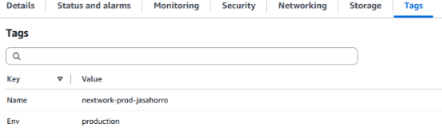

# Cloud Security with AWS IAM

A hands-on NextWork project demonstrating how to use AWS Identity and Access Management (IAM) to enforce least-privilege access control across different environments using resource tags and IAM policies.

---

## What I Built

Set up an IAM policy that restricts an intern/developer account to only interact with EC2 instances tagged as `development` — blocking all access to `production` resources.

---

## Project Steps

### 1. Created an Account Alias
Set up a custom AWS console sign-in URL using an account alias (`nextwork-alias-jasahorro`) to make login easier to share with team members.


---

### 2. Wrote the IAM Policy (JSON)
Created `NextWorkDevEnvironmentPolicy` with three statements:

- **Allow** all `ec2:*` actions on resources tagged `Env: development`
- **Allow** `ec2:Describe*` on all resources (needed to view the console)
- **Deny** `ec2:DeleteTags` and `ec2:CreateTags` on all resources (prevents tag tampering to bypass the policy)


---

### 3. Tagged EC2 Instances by Environment
Tagged EC2 instances with `Env: production` or `Env: development` so the IAM policy conditions could evaluate access correctly.



---

### 4. Tested Access — Intern Cannot Stop Production Instance
Signed in as the intern user (`nextwork-dev-jasahorro`) and attempted to stop the production instance. Access was denied.


---

### 5. Tested Access — Dev User Can Stop Development Instance
The same user successfully stopped the development instance since it matched the allowed tag condition.


---

### 6. Validated with IAM Policy Simulator
Used the IAM Policy Simulator to confirm that `DeleteTags` and `StopInstances` are both denied when tested against the production environment — matching the real-world test results.


---

## Key Concepts Covered

| Concept | Description |
|---|---|
| IAM Policies | JSON documents defining permissions |
| Condition Keys | `ec2:ResourceTag` used to filter by tag |
| Least Privilege | Intern only has access to what they need |
| Tag-based Access Control (TBAC) | Policy decisions based on resource tags |
| IAM Policy Simulator | Tool for testing policies without real consequences |

---

## IAM Policy Used

```json
{
  "Version": "2012-10-17",
  "Statement": [
    {
      "Effect": "Allow",
      "Action": "ec2:*",
      "Resource": "*",
      "Condition": {
        "StringEquals": {
          "ec2:ResourceTag/Env": "development"
        }
      }
    },
    {
      "Effect": "Allow",
      "Action": "ec2:Describe*",
      "Resource": "*"
    },
    {
      "Effect": "Deny",
      "Action": [
        "ec2:DeleteTags",
        "ec2:CreateTags"
      ],
      "Resource": "*"
    }
  ]
}
```

---

## Tools Used

- AWS IAM
- AWS EC2
- IAM Policy Simulator
